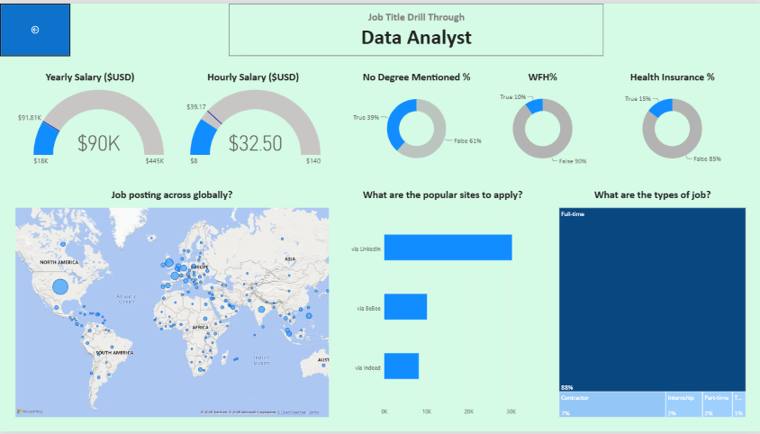

# Data Job Market Analysis Dashboard

## Project Overview

### Background

The data job market is rapidly evolving, making it challenging for aspiring data professionals to understand which roles are in demand, what skills employers prioritize, and what salary expectations exist across different positions.

This project analyzes data-related job postings from 2024 using Power BI to provide a comprehensive view of the job market and help users make informed career decisions

### Business Problem

Job seekers often struggle to answer questions such as:
- Which data roles are most in demand?
- What salary ranges can candidates expect?
- Which job types dominate the market?
- What educational requirements appear most frequently?

The goal of this dashboard is to transform raw job posting data into actionable insights that help users better understand the current data job market.

### Project Objectives

✅ Analyze demand for different data-related roles  
✅ Explore salary trends across jobs 
✅ Evaluate employment type distribution 
✅ Investigate educational requirements 
✅ Enable users to drill into specific job roles for deeper analysis 
✅ Present findings through an interactive Power BI dashboard 

### Target Audience
This dashboard is intended for:

- Aspiring Data Analysts
- Data Scientists
- Business Analysts
- Career changers entering data-related fields
- Students researching the job market

## Tools Used

- Power BI
- Power Query
- Excel

## Dashboard Preview

### Dashboard Navigation

The report consists of two pages:

1. Overview Dashboard
   - High-level market analysis
   - KPI metrics
   - Salary overview
   - Hiring distribution

2. Job Role Drillthrough
   - Role-specific insights
   - Detailed investigation
   - Salary and demand analysis

### Overview Dashboard

#### Purpose

Provides a high-level view of the 2024 data job market and helps users understand hiring demand, salary distribution, employment types, and location trends.

#### Key Features

- Interactive slicers
- KPI cards
- Salary analysis
- Job role comparison
- Geographic insights
- Dynamic filtering

### Job Role Drillthrough

#### Purpose

Allows users to explore an individual job role in greater detail and examine role-specific salaries and hiring characteristics.

#### Key Features

- Drillthrough navigation
- Detailed role exploration
- Focused filtering
- Salary investigation
- Career-specific analysis

## Key Insights

1. Full-time roles dominate postings.
2. Data Analyst roles show strong demand.
3. Degree requirements remain common.
4. Certain locations concentrate hiring activity.

## Skills Demonstrated

- Data Cleaning
- Data Analysis
- Dashboard Development
- Data Storytelling

## Files

- PBIX file
- Screenshots
- Project Report
