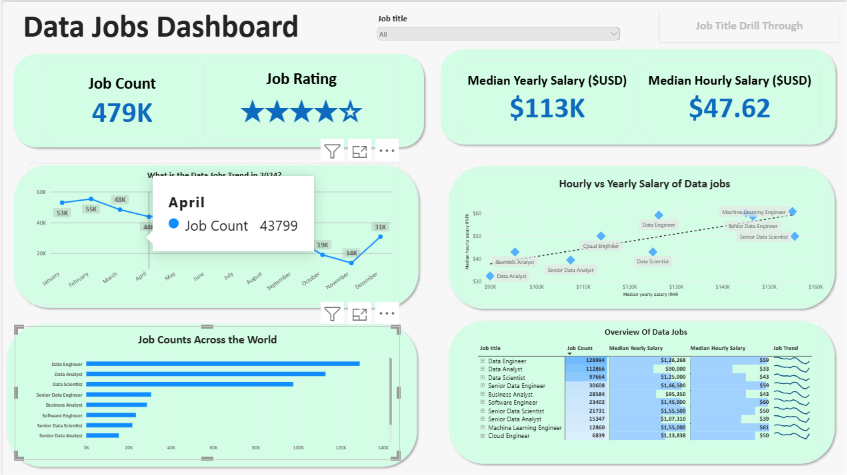

# 📊Data Job Market Analysis Dashboard
### Quick Facts
📌 Dataset Size: 479K Job Postings 
📌 Reporting Tool: Power BI 
📌 Analysis Scope: 2024 Data Job Market 
📌 Dashboard Pages: 2 
📌 Key Focus Areas: 
   1️⃣Salary Trends 
   2️⃣Job Demand 
   3️⃣Employment Types 
   4️⃣Role-Specific Analysis 

## Project Overview

### Background

The data job market is rapidly evolving, making it challenging for aspiring data professionals to understand which roles are in demand, what skills employers prioritize, and what salary expectations exist across different positions.

This project analyzes data-related job postings from 2024 using Power BI to provide a comprehensive view of the job market and help users make informed career decisions

### 🎯 Business Problem

Job seekers often struggle to answer questions such as:
- Which data roles are most in demand?
- What salary ranges can candidates expect?
- Which job types dominate the market?
- What educational requirements appear most frequently?

The goal of this dashboard is to transform raw job posting data into actionable insights that help users better understand the current data job market.

### Project Objectives

✅ Analyze demand for different data-related roles  
✅ Explore salary trends across jobs 
✅ Evaluate employment type distribution 
✅ Investigate educational requirements 
✅ Enable users to drill into specific job roles for deeper analysis 
✅ Present findings through an interactive Power BI dashboard 

### Target Audience
This dashboard is intended for:

- Aspiring Data Analysts
- Data Scientists
- Business Analysts
- Career changers entering data-related fields
- Students researching the job market

## 🛠️ Tools Used

- Power BI
- Power Query
- Excel

## Dashboard Preview

### Dashboard Navigation

The report consists of two pages:

1. Overview Dashboard
   Key Feature 
      ✅ Monthly Hiring Trends 
      ✅ Salary Analysis 
      ✅ Job Market Overview 
      ✅ Interactive Slicers 
      ✅ Conditional Formatting 
      ✅ KPI Tracking 
   
2. Job Role Drillthrough
   Key Feature 
      ✅ Salary Benchmarking 
      ✅ Degree Requirement Analysis 
      ✅ WFH Opportunity Analysis 
      ✅ Benefits Analysis 
      ✅ Employment Type Breakdown 
      ✅ Geographic Distribution 
      ✅ Bookmark Navigation 

### Overview Dashboard

 
*Interactive dashboard summarizing the 2024 data job market, including hiring demand, compensation trends, and employment type distribution.*

#### Purpose

Provides a high-level view of the 2024 data job market and helps users understand hiring demand, salary distribution, employment types, and location trends.

#### Key Features

- Interactive slicers
- KPI cards
- Salary analysis
- Job role comparison
- Geographic insights
- Dynamic filtering

### Job Role Drillthrough

 
*Detailed drillthrough page designed to analyze a specific job role, including salary benchmarks, benefits, remote work opportunities, and hiring characteristics.*

#### Purpose

Allows users to explore an individual job role in greater detail and examine role-specific salaries and hiring characteristics.

#### Key Features

- Drillthrough navigation
- Detailed role exploration
- Focused filtering
- Salary investigation
- Career-specific analysis

## 🔍 Key Insights

### Insight 1: Strong Demand for Data Professionals
The dataset contains approximately 479K job postings, indicating demand for data-related roles throughout 2024. This suggests organizations across industries continue investing heavily in data-driven decision making.

### Insight 2: Data Engineering Leads Hiring Demand
Among all job titles, Data Engineer recorded the highest number of job postings, followed by Data Analyst, Data Scientist, Senior Data Engineer, and Business Analyst. This highlights the growing importance of building and maintaining data infrastructure that supports analytics and AI initiatives.

### Insight 3: Typical Annual Compensation Exceeds $100K
The overall median yearly salary across postings is approximately $113K, suggesting that data-focused careers continue to offer competitive compensation across the market.

### Insight 4: Hiring Activity Peaks Early in the Year
Job postings reached their highest level in February (55K postings) and dropped to their lowest level in November (14K postings). This pattern suggests stronger hiring activity early in the year and slower recruitment activity toward year-end.

### Insight 5: Significant Seasonal Variation Exists
February generated almost 4 times the number of postings compared with November.

### Insight 6: Data Analyst Salaries Remain Competitive
For the Data Analyst role, the median annual salary is approximately $90,000, making it an attractive entry point into the broader data profession.

### Insight 7: Skills May Matter More Than Degrees
- Approximately 39% of Data Analyst postings did not explicitly mention a degree requirement.
- This may indicate that some employers place greater emphasis on practical skills, experience, and analytical capabilities rather than formal academic qualifications alone.

### Insight 8: Remote Opportunities Are Limited
- Only 10% of Data Analyst postings were classified as work-from-home opportunities.
- This suggests that many employers continue to prefer hybrid or on-site arrangements for analyst roles.
- While Data Analyst roles remain highly demanded, only 10% of postings offer remote work arrangements, suggesting that geographic flexibility may be more limited than many candidates expect.

### Insight 9: Benefits Are Not Always Disclosed
- Only 15% of postings explicitly mentioned health insurance benefits.
- This may reflect incomplete job-posting information rather than the actual absence of benefits. Analysts should be cautious when interpreting benefit-related fields.

### Insight 10: LinkedIn Dominates Job Discovery
The majority of Data Analyst postings were found on LinkedIn, followed by BeBee and Indeed. Aspiring analysts may benefit from prioritizing these platforms during their job search.

### Insight 11: Full-Time Employment Dominates the Market
- Approximately 88% of Data Analyst postings were classified as full-time positions.
- This indicates that employers primarily seek long-term analytical talent rather than temporary or contract-based resources.

## ⚙️ Power BI Features Demonstrated

### Data Preparation
- Imported and analyzed job posting data from Excel.
- Performed data cleaning and transformation using Power Query.
- Standardized salary-related fields for consistent analysis.
- Prepared data for dashboard reporting and visualization.

### Data Modeling

Although this project uses a single dataset, measures and calculations were created to support interactive analysis and business insights.

### Interactive Analysis Features
Implemented: 
✅ Slicers 
✅ Cross-filtering 
✅ Drillthrough navigation 
✅ Dynamic KPI cards 
✅ Bookmark navigation 
✅ Interactive role exploration 

### Data Visualization Techniques
The report incorporates multiple visualization types to communicate insights effectively:
| Visual | Purpose |
|---------|---------|
| KPI Cards | Display high-level summary metrics such as total job count and median salary. |
| Line Chart | Visualize monthly hiring trends throughout 2024. |
| Scatter Plot | Explore relationships between hourly and yearly salaries across job roles. |
| Bar Chart | Compare hiring demand across different job titles. |
| Matrix | Provide detailed role-level summaries with salary metrics and job trends. |
| Gauge Charts | Benchmark median salaries against average salary targets. |
| Donut Charts | Highlight percentage-based metrics such as WFH opportunities, degree requirements, and health insurance coverage. |
| Treemap | Analyze employment type distribution (Full-Time, Part-Time, Contract, Internship). |
| Map Visual | Visualize the geographic distribution of job opportunities worldwide. |

### Dashboard Design Enhancements
- Implemented several reporting best practices:
- Conditional formatting in matrix visual
- Bookmark-enabled navigation
- Custom button interactions
- Consistent color palette
- Interactive filtering experience
- Business-focused dashboard layout

## Files

- PBIX file
- Screenshots
- Project Report
